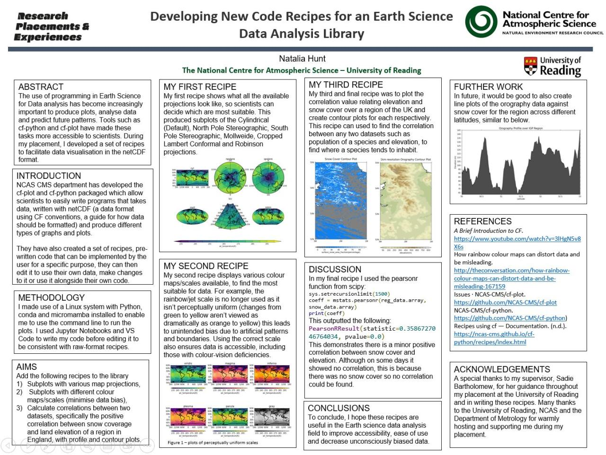

# Recipes-for-an-Earth-Science-Data-Analysis-Library
I developed a set of recipes to facilitate data visualisation in the netCDF format. These recipes include: 1) generating subplots with various map projections, 2) creating subplots with different colour maps/scales to minimise bias in data presentation, and 3) calculating correlations between datasets.

## Documents
- [Final Report](Developing_New_Code_Recipes_for_an_Earth_Science_Data_Analysis_Library_Final_Report_by_Natalia_Hunt.pdf)
- [Recipe 1: Plotting contour subplots with different projections (online)](https://ncas-cms.github.io/cf-python/recipes/plot_16_recipe.html#sphx-glr-recipes-plot-16-recipe-py)
- [Recipe 2: Plotting contour subplots with different colour maps/scales (online)](https://ncas-cms.github.io/cf-python/recipes/plot_17_recipe.html#sphx-glr-recipes-plot-17-recipe-py)
- [Recipe 3: Calculating the Pearson correlation coefficient between datasets (online)](https://ncas-cms.github.io/cf-python/recipes/plot_18_recipe.html#sphx-glr-recipes-plot-18-recipe-py)

